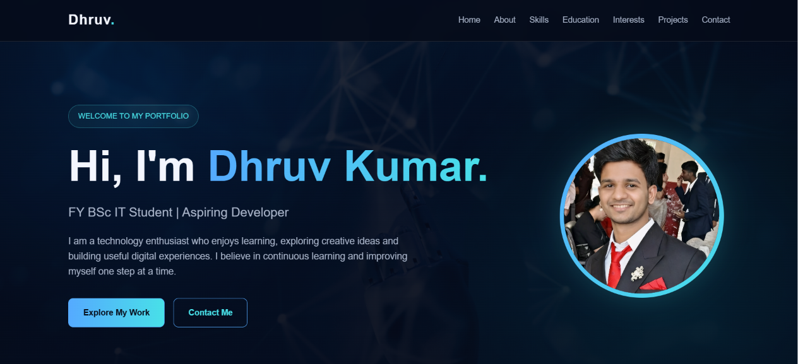

# 👨‍💻 Dhruv Kumar | Personal Portfolio

Welcome to my personal portfolio website! I am Dhruv Kumar, a First-Year B.Sc. Information Technology student at Jai Hind College, Mumbai.

I am passionate about technology, programming, web development, and Artificial Intelligence.

## 🌐 Live Website

[Visit My Portfolio](https://dhruvkumar-it.github.io/dhruv-portfolio/)

## 👨‍🎓 About Me

- **Name:** Dhruv Kumar
- **Education:** B.Sc. Information Technology
- **College:** Jai Hind College, Mumbai
- **Interests:** Web Development, Programming, AI and Creative Activities
- **Email:** dk4518482@gmail.com

## 🛠️ Technologies Used

- HTML5
- CSS3
- JavaScript
- Git & GitHub

## 🚀 Features

- Modern and responsive design
- Personal introduction and education details
- Skills and interests section
- Projects showcase
- Contact information
- Profile picture

## 📂 Project Structure

```text
dhruv-portfolio/
├── index.html
├── profile.png
└── README.md
```

## 🔗 Connect With Me

- **GitHub:** [dhruvkumar-IT](https://github.com/dhruvkumar-IT)
- **LinkedIn:** [My LinkedIn Profile](https://www.linkedin.com/in/dhruvkumar/)
- **Email:** [Contact Me](mailto:dk4518482@gmail.com)

---

⭐ Thank you for visiting my portfolio!
## 📸 Portfolio Preview


